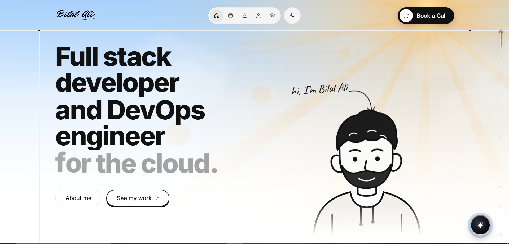

<div align="center">

<picture>
  <source media="(prefers-color-scheme: dark)" srcset=".github/assets/banner-dark.svg">
  
</picture>

<br />
<br />

<a href="https://nextjs.org"></a>
<a href="https://react.dev"></a>
<a href="https://www.typescriptlang.org"></a>
<a href="https://gsap.com"></a>
<a href="https://lenis.darkroom.engineering"></a>
<a href="https://js.langchain.com"></a>
<a href="https://nodemailer.com"></a>

<br />

**A hand-crafted portfolio with a living weather sky, scroll-driven 3D devices,<br />and an AI assistant that knows my work.**

<a href="https://www.linkedin.com/in/bilal-ali-dev/">LinkedIn</a> ·
<a href="https://github.com/Bilalwebdev26">GitHub</a> ·
<a href="mailto:bilalwdev26@gmail.com">bilalwdev26@gmail.com</a>

</div>

<br />

<p align="center">
  
</p>

<p align="center"><sub>The hero: a weather sky that cycles sun, clouds, rain and snow (and a moon at night), a headline that evaporates between words, and the header with signature logo, section nav, theme toggle and <b>Book a Call</b>.</sub></p>

---

## ✦ Highlights

| | |
|---|---|
| **Intro loader** | Multilingual greeting carousel, live counter and a curved-edge reveal into the page. |
| **Living sky** | Canvas weather that cycles sunshine → clouds → rain (with lightning) → snow. Night mode swaps the sun for a cratered moon, stars and shooting stars. |
| **Evaporating text** | The last headline line dissolves letter by letter into the next word. |
| **Buttery scroll** | Lenis smooth scrolling driven by GSAP's ticker, with ScrollTrigger reveals, split-text, scrubbed word fills and a velocity marquee. |
| **3D devices in pure CSS** | Projects open on a real 3D MacBook (lid, keyboard, trackpad), n8n workflows sit on a 3D studio display — both swing into place on scroll. |
| **Scroll-linked stack** | Five rows of tool logos that drift on their own and react to scroll speed and direction. |
| **AI assistant** | LangChain + Gemini, grounded in [`content/bilal.md`](content/bilal.md). Answers in 1–3 sentences, renders project cards, contact links and an inline booking form — with a gradient wash, rising stardust and a "Generating response" state. |
| **Book a call** | Popup and in-chat forms send a branded HTML email through Nodemailer, then celebrate with a check, paper plane and confetti. |
| **Custom scroll rail** | Section markers, live percentage, draggable thumb and a velocity-stretched indicator. |
| **Details** | Light / dark themes, custom arrow & hand cursors, magnetic buttons, reduced-motion support and accessible dialogs. |

## ✦ Featured work

| # | Project | What it is | Stack | Live |
|:-:|---|---|---|---|
| 01 | **NoDelay AI** | AI studio — agents, automations and assistants wired into business stacks | Next.js · Node.js · OpenAI · MongoDB | [visit ↗](https://nodelayai.vercel.app/) |
| 02 | **payTransit** | Payroll SaaS — payroll, time & leave, bank-ready exports | Next.js · NestJS · PostgreSQL · Stripe | [visit ↗](https://pay-transit.vercel.app/) |
| 03 | **PetDen** | UK pet-supplies marketplace with next-day delivery | Next.js · Node.js · MongoDB · Stripe | [visit ↗](https://www.petden.co.uk/) |
| 04 | **Qwess** | Package tracking by number or manifest | React · Node.js · PostgreSQL | [visit ↗](https://quess.vercel.app/) |
| 05 | **Reachly** | Pakistan's first creator booking platform | Next.js · Node.js · MongoDB | [visit ↗](https://reachly-indol-theta.vercel.app/) |

**n8n automations** — a WhatsApp AI agent for restaurants (RAG + memory), a multi-agent WhatsApp assistant (calendar, Gmail, tasks, research) and an AI ops agent for Jira, Google Sheets and Gmail.

## ✦ Built with

| Area | Tools |
|---|---|
| Framework | Next.js 16 (App Router, Turbopack), React 19, TypeScript |
| Motion | GSAP + ScrollTrigger, Lenis, CSS 3D transforms, Canvas 2D |
| AI | LangChain (`@langchain/google-genai`) with Gemini Flash-Lite |
| Email | Nodemailer over SMTP, table-based HTML template |
| Styling | Hand-written CSS with design tokens, light / dark themes |
| Fonts | Inter, JetBrains Mono, Caveat via `next/font` |

## ✦ Project structure

```text
.
├── content/
│   └── bilal.md                 # knowledge base the AI assistant answers from
├── public/
│   ├── screen-shots/ · lab/     # project & n8n screenshots
│   ├── stack-logos/ · company-logos/ · contact-logos/
│   └── cursors/                 # light & dark arrow / hand cursors
└── src/
    ├── app/
    │   ├── api/chat/route.ts    # LangChain + Gemini assistant
    │   ├── api/contact/route.ts # Nodemailer booking emails
    │   ├── layout.tsx · page.tsx · globals.css · icon.svg
    ├── components/
    │   ├── sections/            # Hero, Intro, Works, Lab, About, Stack, Quote, Footer
    │   ├── ChatBot.tsx          # orb → input bar → gradient wash + replies
    │   ├── ProjectShowcase.tsx  # 3D MacBook rows
    │   ├── WeatherSky.tsx       # canvas sun / moon / clouds / rain / snow
    │   ├── BookCallModal.tsx · SuccessBurst.tsx · ScrollRail.tsx · …
    ├── data/site.ts             # all editable content: projects, stack, links
    └── lib/                     # scroll helpers, contact client, email template
```

## ✦ Getting started

**Requirements:** Node.js 20 or newer.

```bash
git clone https://github.com/Bilal-Ali-wdev/bilal-portfollio.git
cd bilal-portfollio
npm install
cp .env.example .env.local   # then fill in the values below
npm run dev                  # http://localhost:3000
```

### Environment variables

Create `.env.local` in the project root. It's git-ignored — never commit real keys.

| Variable | Purpose | Example |
|---|---|---|
| `GOOGLE_API_KEY` | Gemini API key for the AI assistant | `your-gemini-api-key` |
| `GEMINI_MODEL` | Model name (optional) | `gemini-3.5-flash-lite` |
| `EMAIL_HOST` | SMTP server | `smtp.example.com` |
| `EMAIL_PORT` | SMTP port | `587` |
| `EMAIL_SECURE` | `true` for port 465, `false` for 587 (STARTTLS) | `false` |
| `EMAIL_USER` | SMTP username | `noreply@example.com` |
| `EMAIL_PASS` | SMTP password — write any `$` as `\$` | `your-smtp-password` |
| `EMAIL_FROM` | Sender address | `noreply@example.com` |
| `CONTACT_TO` | Where booking emails are delivered | `you@example.com` |

### Scripts

| Command | What it does |
|---|---|
| `npm run dev` | Start the dev server |
| `npm run build` | Production build |
| `npm run start` | Serve the production build |
| `npm run lint` | Run ESLint |

## ✦ Make it yours

- **Content** — projects, stack rows, journey, links and copy live in [`src/data/site.ts`](src/data/site.ts).
- **AI knowledge** — edit [`content/bilal.md`](content/bilal.md); keep it short, it's sent with every question.
- **Images** — drop screenshots into `public/screen-shots` (projects) or `public/lab` (workflows) and reference them in `site.ts`.
- **Theme** — colour tokens sit at the top of [`src/app/globals.css`](src/app/globals.css), with a light and a dark set.

## ✦ Deploying

Deploys anywhere that runs Next.js — [Vercel](https://vercel.com) is the easiest. Add the environment variables above in your host's settings; `next.config.ts` already ships `content/bilal.md` with the chat route.

---

<div align="center">

**Bilal Ali** · Associate Software Developer at Codev Digital · BSCS, UMT

<a href="https://www.linkedin.com/in/bilal-ali-dev/"></a>
<a href="https://github.com/Bilalwebdev26"></a>
<a href="mailto:bilalwdev26@gmail.com"></a>

<sub>© 2026 Bilal Ali. Designed and built by hand.</sub>

</div>
